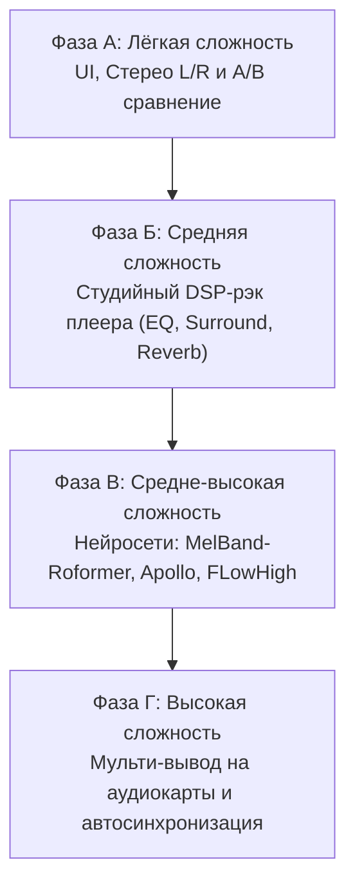

# Product & Audio Engineering Roadmap

Дорожная карта функционального развития аудио-пайплайна, библиотек и продуктовых возможностей платформы **Music Upscaler Platform**.

Документ дополняет системную техническую архитектуру ([`docs/ARCHITECTURE_ROADMAP.md`](file:///f:/projects/private--music_upscaler/docs/ARCHITECTURE_ROADMAP.md)) и фокусируется на звуковой обработке, алгоритмах, форматах, детекции/очистке AI-маркеров и музыкальной аналитике.

---

## 1. Миссия и продуктовое позиционирование

Сервис позиционируется как **рабочее пространство пост-продакшена и студийной доводки аудио**:

1. **Пост-обработка AI-генераций (Suno, Udio и др.):** устранение цифрового «песка», коробочного резонанса, фазового звона, восстановление срезанного верха и полное «отклеивание» трека от маркеров генераторов для безопасной дистрибуции.
2. **Восстановление домашнего и архивного аудио:** апскейлинг старых записей, диктофонов, пережатых MP3 и демок.
3. **Универсальный транскодер и менеджер медиатеки:** конвертация в обе стороны (MP3 -> Lossless и Hi-Res FLAC/WAV -> сжатые форматы) с сохранением метаданных.
4. **Музыкальная аналитика:** определение BPM, тональности, спектральный анализ качества.

---

## 2. Стек библиотек: назначение и зоны ответственности

### Текущие библиотеки в ядре

- **`soundfile` (`sf`):** Высокоскоростное чтение и запись несжатого/lossless аудио (WAV, FLAC, OGG) напрямую в массивы NumPy без промежуточных потерь, с поддержкой 16-bit, 24-bit PCM и 32-bit float.
- **`numpy` (`np`):** Быстрая математика над многоканальными массивами: фазовые преобразования, Mid-Side разделение каналов, суммирование стемов при ресинтезе, расчёт уровней RMS и пиковых значений.
- **`pydub` (`AudioSegment`):** Финальный экспорт с заданным битрейтом (MP3, OGG), фоллбэк-декодирование экзотических форматов через FFmpeg, операции монтажа.
- **`pedalboard` (Spotify):** Студийные DSP-эффекты реального времени (параметрический эквалайзер, фильтры среза, винтажный компрессор, лимитер, сатурация, реверберация).
- **`torch` + `torchaudio`:** Вычисления нейросетевых моделей на GPU (CUDA) и CPU, передискретизация (resampling) с высоким качеством.
- **`audiosr`:** Диффузионная модель аудио-суперразрешения (Audio Super-Resolution) для генерации отсутствующих высоких частот вплоть до 48 кГц.
- **`demucs` (Meta):** Нейросетевое разделение микса на независимые стемы (вокал, ударные, бас, остальное) для гибридной обработки и ресинтеза.
- **`mutagen`:** Чтение и запись ID3, Vorbis Comments, FLAC Pictures, извлечение и внедрение обложек альбомов.

### Новые запланированные библиотеки

- **`librosa` (Запланировано к установке):**
  - _BPM Detection & Beat Tracking:_ автоматическое определение темпа и сетки долей трека.
  - _Key / Scale Estimation:_ распознавание музыкальной тональности (например, _C Minor_, _F# Major_) на базе CQT-хромограмм.
  - _Smart Silence Trimming:_ умный поиск начала и конца звука (`librosa.effects.trim`) без ручной подгонки.
  - _Time-Stretching & Pitch-Shifting:_ изменение тональности трека для караоке без изменения скорости и изменение темпа без изменения высоты тона.
  - _Advanced Spectral Analytics:_ расчёт объективных спектральных метрик (Spectral Centroid, Rolloff, Spectral Contrast) для отчетов качества.
- **`pathlib` (Встроен в Python):**
  - Полный рефакторинг работы с файловой системой: замена устаревших `os.path.join/splitext/basename` на объектные `Path` (`path.suffix`, `path.stem`, `path.with_suffix()`).
  - Безопасная кроссплатформенность путей между Windows и Linux/Docker.
- **`IPython.display` (`Audio, display`):**
  - Инструмент для внутренней R&D-лаборатории в Jupyter Notebooks (`notebooks/`). Позволяет мгновенно прослушивать результаты работы DSP-цепочек и AI-моделей в ячейках блокнота перед отправкой в продакшен.

---

## 3. Ключевые функциональные направления

### 3.1. Двусторонняя конвертация и Direct Convert (Без AI)

- **Режим «Прямая конвертация» (Direct Passthrough):**
  - Возможность конвертировать треки (например, тяжелый 24-bit FLAC/WAV в компактный MP3 320 kbps) за 1–2 секунды через FFmpeg в обход тяжелых нейросетей AudioSR и DSP-фильтров.
- **Расширение линейки целевых форматов:**
  - **AAC / M4A (`.m4a`):** отраслевой стандарт Apple Music, YouTube и мобильных устройств;
  - **Opus (`.opus`):** самый передовой lossy-кодек с максимальной детализацией на низких битрейтах;
  - **AIFF (`.aiff`):** несжатый студийный формат для DJ-экосистем (Pioneer CDJ, Rekordbox).
- **Сквозной перенос метаданных:**
  - Автоматический перенос тегов (Artist, Title, Album, Year) и вшитой обложки из исходного FLAC/WAV прямо в выходной MP3/M4A через `mutagen`.

---

### 3.2. Stealth Mastering & Anti-AI Protection («Отклеивание» от маркеров Suno/Udio)

Комплексная защита от автоматических чекеров дистрибьюторов (DistroKid, TuneCore, Believe) и стриминговых платформ на 4 уровнях:

1. **Уровень 1: Полный вайп метаданных и контейнера:**
   - Удаление служебных строк энкодера (`Lavf`, FFmpeg-билды генераторов).
   - Очистка скрытых ID3v2/Vorbis полей, в которых Suno/Udio сохраняют UUID трека, аккаунт или промпт.
   - Формирование чистого контейнера со стандартным студийным заголовком (чистый LAME 3.100).
2. **Уровень 2: Разрушение акустических водяных знаков (Acoustic Watermarks):**
   - Разложение трека на 4 изолированных стема через Demucs с последующей рекомбинацией (re-synthesis).
   - Разрушение фазовой когерентности, на которой базируются скрытые неслышимые метки (типа SynthID / AudioSeal).
3. **Уровень 3: Спектральная маскировка и устранение частотных сигнатур:**
   - **AudioSR Re-generation:** генерация натурального высокочастотного спектра выше 15–16 кГц вплоть до 48 кГц (ликвидация характерного «среза» Suno).
   - **De-mud EQ:** хирургический вырез коробки и пластикового гула на частотах 300–400 Гц.
   - **De-harsh EQ:** подавление металлического фазового резонанса нейросети в полосе 3–5 кГц.
   - **Mid-Side Stereo Widener:** расширение узкой, фазово-сплющенной стереобазы AI-генератора до коммерческого объема.
4. **Уровень 4: Продвинутые приёмы де-идентификации:**
   - **Analog Drift (Микро-девиация):** незаметный на слух сдвиг темпа на 0.1–0.3% (Time-stretch) или высоты тона на 2–3 цента. Ломает спектральные хеш-суммы чекеров.
   - **Warm Tape Noise Floor:** подмешивание едва уловимого аналогового шума ленты (-65 dB), устраняющего неестественную «математическую тишину» генератора.
   - **Harmonic Exciter:** обогащение микса живыми гармониками через сатуратор.

---

### 3.3. Музыкальная аналитика и продюсерский инструментарий (на базе `librosa`)

- **BPM & Key Badges:** вывод темпа и тональности в библиотеке треков, карточке деталей и плеере.
- **Smart Silence Trimmer:** автоматическое удаление пустых пауз в начале и конце сгенерированных треков.
- **Караоке-модуль:** подавление вокала (через Demucs) в комбинации с Pitch-Shift на базе `librosa` (подгонка тональности под вокальный диапазон пользователя).
- **Сравнительные спектрограммы «До / После»:** наглядный визуализатор частот, показывающий пользователю реальный прирост качества.

---

### 3.4. Монтажные и платформенные возможности (на базе `pydub`)

- **30-секундный Snippet Generator:** автоматическая нарезка самого сочного фрагмента трека с `fade_in` / `fade_out` для быстрого ознакомления в ленте.
- **Audio Watermarking (Free Tier):** аккуратное наложение тихого звукового водяного знака сервиса для бесплатных пользователей.
- **Склейка и микширование:** объединение нескольких сгенерированных фрагментов в один полноценный трек.

---

### 3.5. Новое поколение нейросетей Super-Resolution и стем-сплиттеров (2025–2026)

- **Apollo (Band-sequence Modeling for Audio Restoration):**
  - Профильная трансформерная модель восстановления музыкальных треков (обучена на MUSDB18-HQ и MoisesDB).
  - Работает через явное разделение на частотные поддиапазоны (sub-bands): физически не затрагивает низкие и средние частоты, достраивая строго недостающий ВЧ-спектр без диффузионного шума и без окрашивания вокала.
- **FLowHigh (ICASSP 2025):**
  - Апскейлер нового поколения на базе **Flow Matching** (Continuous Normalizing Flows).
  - Заменяет 50 шагов классической диффузии на 1–4 шага ODE-солвера, сокращая время апскейла 5-минутного трека с 14 минут до ~40 секунд.
- **Latent Bridge Models (AudioLBM):**
  - Schrödinger Bridge от латентного пространства LR к HR вместо генерации из белого шума.
  - Frequency-aware кондиционирование и поддержка сверхвысоких частот дискретизации (до 96 и 192 кГц).
- **NovaSR & FastWave (2026):**
  - Ультралегковесные BWE-модели (~1.3M параметров на базе ConvNeXtV2/EDM) для мгновенной обработки в реальном времени даже на слабых GPU.
- **Resemble Enhance (Denoiser + Vocoder BWE):**
  - Двухстадийный комбайн для глубокой очистки и восстановления вокальных стемов (устранение роботизированного и металлического призвука Suno).
- **MelBand-Roformer & BS-Roformer:**
  - Топовые стем-сплиттеры, обошедшие Demucs v4 на бенчмарках SDR (11–13 дБ против 9 дБ у Demucs).
  - Обеспечивают изоляцию вокала, ударных и баса с нулевым взаимопроникновением (zero bleed) и отсутствием фазовой гребенчатости.
- **Деконструкция ComfyUI_MusicTools (автор jeankassio):**
  - Скачивание и детальный разбор воркфлоу ComfyUI.
  - Пошаговое портирование и перенос архитектуры узлов 1:1 в наш бэкенд `StudioDSP`:
    - `Music Fix` (устранение частотной мутности 200–500 Гц и клиппинга);
    - `Audio Repair` (подавление щелчков, кликов и смещения фазы DC offset);
    - `Master Audio Enhancement` (многополосная аналоговая динамика и психоакустическая сатурация);
    - `LUFS Normalizer` (-14 LUFS Spotify / -16 LUFS Apple Music).

---

### 3.6. Hi-Res Проигрыватель, Стерео-спектрограмма L/R и Студийная панель улучшения звука

1. **Стерео-спектрограмма (L / R Dual-Channel Split View):**
   - Раздельный спектральный анализ для левого ($L$) и правого ($R$) каналов без моно-микширования.
   - Side-by-side или двухполосный вид (L сверху, R снизу) для оригинала и обработанного файла с цветовой тепловой картой мощности (dB).
   - Индикатор разностного сигнала ($\text{Side} = L - R$) и фазовой корреляции / стерео-гониометра для проверки ширины сцены и фазовой совместимости.

2. **Бесшовное A/B предпрослушивание и сравнение:**
   - Единый транспорт воспроизведения (один Play/Pause, единый таймлайн, общая полоса перемотки).
   - Мгновенный свитчер **A (Оригинал) / B (Обработанный)** без прерывания воспроизведения и с 5-мс микро-кроссфейдом (исключает щелчки).
   - Режим **Delta / Difference Solo** — возможность услышать изолированно только то, что добавила или изменила нейросеть / DSP.

3. **Hi-Res Audio Playback Engine (Без искажений и ресемплинга):**
   - Внедрение Web Audio API 32-bit floating point аудио-пайплайна или интеграция audiophile-плеера без системного клиппинга и искажений динамического диапазона.
   - Битовая точность (Bit-perfect playback) для FLAC 24-bit / 48–96 кГц.

4. **Панель «Улучшение звука» (Player DSP Control Rack):**
   - **10-полосный эквалайзер:** ползунки 32 Гц, 64 Гц, 125 Гц, 250 Гц, 500 Гц, 1 кГц, 2 кГц, 4 кГц, 8 кГц, 16 кГц (диапазон -12 dB .. +12 dB) с тумблером ON/OFF и селектором пресетов (Flat, Rock, Electronic, Vocal Boost, Bass Heavy, Acoustic, Air Highs, Custom).
   - **Bass Boost:** плавный слайдер усиления суб-баса (40–80 Гц) с фазолинейным фильтром + тумблер ON/OFF.
   - **Voice Clarity:** слайдер интеллектуального выделения вокального диапазона (1–3.5 кГц) с подавлением маскирующих резонансов + тумблер ON/OFF.
   - **Compressor:** слайдер динамической плотности микса (компрессор/лимитер с авто-компенсацией громкости) + тумблер ON/OFF.
   - **Virtual Surround (Пространственное звучание):**
     - Селектор пресетов (Front-Panned, Wide 3D, Cinema, Studio).
     - **Интерактивный круговой виджет акустической сцены:** круговая диаграмма с виртуальными динамиками вокруг слушателя и кнопкой тест-прослушивания по центру.
   - **Reverb:** ревербератор с выбором акустических пространств (Live, Room, Hall, Studio, Cathedral), тумблером ON/OFF и слайдером глубины/затухания.

---

### 3.7. Архитектура мульти-вывода на звуковые карты с автосинхронизацией

Разделение подсистемы работы со звуковыми картами на **4 строгие логические категории**:

1. **Категория 1: Discovery & Telemetry (Определение и параметры звуковых карт)**
   - Опрос аудиоинтерфейсов через API ОС (WASAPI / DirectSound / CoreAudio / `sounddevice` / `pycaw`) и в браузере (`navigator.mediaDevices.enumerateDevices()`, `kind="audiooutput"`).
   - Сбор аппаратной телеметрии: наименование (Realtek, USB DAC, HDMI/DisplayPort, Bluetooth), поддерживаемые частоты дискретизации (44.1, 48, 96, 192 кГц), разрядность (16/24/32-bit), базовые задержки драйвера (`baseLatency`, `outputLatency`).
   - Обработка событий горячего подключения (Plug & Play): автоматическое обнаружение подключения внешнего USB-ЦАПа или беспроводных наушников.

2. **Категория 2: Multi-Device Routing (Параллельная маршрутизация)**
   - Поддержка одновременного вещания на **несколько аудиокарт** (например, встроенные динамики ноутбука + внешний USB-ЦАП/аудиоинтерфейс).
   - Независимые аудиопотоки (`AudioContext` / `setSinkId(deviceId)` в вебе или параллельные потоки `sounddevice.OutputStream` на бэкенде).
   - Матричный селектор выходов: выбор устройств чекбоксами с независимой регулировкой громкости для каждого устройства.

3. **Категория 3: Latency Alignment & Auto-Sync (Синхронизация буферов и задержек)**
   - *Проблема:* разница внутренних буферов USB-ЦАПа (15–30 мс), Realtek (50–80 мс) и Bluetooth (150–250 мс) создаёт эффект фазового эха и рассинхрона.
   - *Механизм автовыравнивания:*
     - Расчёт максимальной задержки $L_{\max} = \max_i(L_i)$.
     - Динамическое включение Delay Line (задержки) $\Delta t_i = L_{\max} - L_i$ на быстрых устройствах.
   - *Калибровочный импульс (Auto-Sync Test Pulse):* генерация короткого тестового щелчка (Dirac pulse / chirp) для проверки и автоматической калибровки временного сдвига.
   - Ручной слайдер Micro-Delay (±100 мс с шагом 0.5 мс) с сохранением профиля синхронизации для связки устройств.

4. **Категория 4: Clock Drift Compensation (Компенсация расхождения кварцевых генераторов)**
   - Компенсация расхождения физических кварцев разных карт (Clock Drift) на длинных треках (когда за 5 минут одна карта успевает воспроизвести на 50 мс больше сэмплов, чем другая).
   - Мягкий кольцевой ресэмплинг (Fractional Delay / Micro-Pitch Resampling $\pm 0.01\%$) для удержания абсолютной фазовой синхронности на протяжении всего трека.

---

## 4. Этапы реализации (Milestones) — Ранжирование по степени сложности

### Завершённые этапы (Базовый фундамент)

- [x] **Этап 1: Форматы, прямая конвертация и безопасность путей** (Pathlib, Direct-режим, AAC/Opus, Mutagen).
- [x] **Этап 2: Пресет «Stealth / Anti-AI»** (De-mud, De-harsh, Stereo Widen, Tape Saturation, Analog Drift).
- [x] **Этап 3: Аналитика и интеграция `librosa`** (BPM, Key, Smart Silence Trim).
- [x] **Этап 4: Акустический тюнинг AudioSR** (LR4 Zero-Phase Crossover на 15.5 кГц, Natural Air Stereo Spreader).

---

### План дальнейшей разработки (От самого лёгкого к самому сложному)

---

### ФАЗА А: Лёгкая сложность (Quick Wins / Высокий визуальный эффект)
*Трудоёмкость: 1–2 дня. Риски: минимальные.*

- [ ] **1. Стерео-спектрограмма L / R (Dual-Panel):**
  - Раздельный спектральный анализ левого ($L$) и правого ($R$) каналов без моно-микширования.
  - Двухполосный вид (L сверху, R снизу) для оригинала и апскейла с тепловой картой мощности (dB).
  - Индикатор разностного сигнала ($\text{Side} = L - R$) и стерео-корреляции.
- [ ] **2. Бесшовный синхронный A/B плеер сравнения:**
  - Единый таймлайн и один общий Play/Pause.
  - Мгновенное переключение **A (Оригинал) / B (Обработанный)** без прерывания позиции трека и с 5-мс микро-кроссфейдом (без щелчков).
  - Режим **Delta / Difference Solo** (прослушивание только добавленных нейросетью частот).
- [ ] **3. Обновление модального окна апскейла в UI (со спектральным Pro-Q пре-фильтром):**
  - Селектор движков (`Stealth`, `AudioSR Ultra`, `Apollo`, `FLowHigh`).
  - Готовые пресеты (`Mastering`, `Vocal Polish`, `Club Bass`, `Broadcast`, `Tape Warmth`, `Natural Air`).
  - **Визуальный параметрический Pro-Q пре-фильтр в модалке:** отображение реального спектра загруженного трека, визуальная подгонка частоты среза кроссовера (вертикальный маркер среза Suno/MP3), точечные Notch-фильтры для вырезания паразитных резонансов до подачи в AI и сохранение собственных пресетов.
- [ ] **4. Деконструкция `ComfyUI_MusicTools` (jeankassio):**
  - Анализ открытого репозитория `jeankassio/ComfyUI_MusicTools`.
  - Прямой перенос логики `Music Fix` (вырез мути 200–500 Гц) и `Audio Repair` (де-клиппер, де-кликкер) в бэкенд `music/services/dsp.py`.

---

### ФАЗА Б: Средняя сложность (Студийный Hi-Res плеер и DSP-рэк по референсам)
*Трудоёмкость: 2–3 дня. Риски: низкие (чистый Web Audio API).*

- [ ] **1. Эквалайзер плеера: Двойной режим (Слайдеры $\leftrightarrow$ FabFilter Pro-Q 3):**
  - **Классический режим (10 слайдеров):**
    - Ползунки: 32, 64, 125, 250, 500, 1K, 2K, 4K, 8K, 16K (диапазон -12 .. +12 dB) на базе `BiquadFilterNode`.
    - Тумблер ON / OFF и пресеты (Flat, Rock, Electronic, Vocal Boost, Bass Heavy, Acoustic, Custom).
  - **Расширенный режим (Visual Spectrum EQ в стиле FabFilter Pro-Q 3):**
    - Живой 60 FPS анализатор спектра в реальном времени (`AnalyserNode` + Canvas 2D) на фоне.
    - Интерактивная плавная кривая АЧХ с цветными узлами (Nodes).
    - Перетаскивание точек мышкой: X (частота в Гц), Y (усиление в dB), колёсико мыши (ширина полосы / добротность Q).
    - Выбор типов фильтра для точки: Bell (колокол), Low-Cut, High-Shelf, Low-Shelf, Notch.
- [ ] **2. Блок динамики и окраса:**
  - **Bass Boost:** слайдер суб-баса 40–80 Гц + ON/OFF.
  - **Voice Clarity:** слайдер интеллектуального подъёма формант вокала (1–3.5 кГц) + ON/OFF.
  - **Compressor:** нативный `DynamicsCompressorNode` с авто-компенсацией громкости + ON/OFF.
- [ ] **3. Блок пространственной обработки (Регулировка):**
  - **Virtual Surround:** пресеты (Front-Panned, Wide 3D, Cinema, Studio) + интерактивный круговой виджет виртуальных колонок с центральной кнопкой тест-прослушивания.
  - **Reverb:** конволюционный ревербератор с выбором комнат (Live, Room, Hall, Cathedral) и слайдером затухания.
- [ ] **4. Hi-Res Playback Engine:**
  - Битовая точность (Bit-perfect playback) для FLAC 24-bit 48/96 кГц без системного клиппинга Windows.

---

### ФАЗА В: Средне-высокая сложность (Стем-сплиттеры и новое поколение AI-моделей)
*Трудоёмкость: 3–5 дней. Риски: умеренные (управление весами моделей и VRAM).*

- [ ] **1. Апгрейд сплиттера: MelBand-Roformer & BS-Roformer:**
  - Замена Demucs v4 на MelBand-Roformer (прирост SDR с 9 dB до 11–13 dB).
  - Изоляция вокала, ударных и баса с нулевым взаимопроникновением (zero bleed).
- [ ] **2. Интеграция Apollo (Band-sequence music restoration):**
  - Профильная музыкальная модель sub-band реставрации без диффузионного шума и без окрашивания вокала.
- [ ] **3. Интеграция FLowHigh:**
  - Flow Matching апскейл до 48 кГц за 1–4 шага ODE-солвера (сокращение времени апскейла с 14 мин до ~40 сек).
- [ ] **4. Интеграция NovaSR & FastWave:**
  - Экспресс-режим (~1.3M параметров) для слабых ПК и ноутбуков без мощной дискретной видеокарты.
- [ ] **5. Интеграция Resemble Enhance:**
  - Двухстадийная очистка вокальных стемов от роботизированного призвука Suno.

---

### ФАЗА Г: Высокая сложность (Мульти-вывод на звуковые карты и автосинхронизация)
*Трудоёмкость: 5–8 дней. Риски: системные различия аудиодрайверов и аппаратные задержки.*

- [ ] **1. Категория 1: Discovery & Telemetry (Определение карт):**
  - Опрос устройств через OS API (WASAPI/`sounddevice`) и Web Audio (`enumerateDevices()`).
  - Сбор характеристик (Realtek, USB DAC, Bluetooth, HDMI), частот дискретизации и аппаратных задержек буферов (`baseLatency`, `outputLatency`).
  - Горячее подключение (Plug & Play детекция USB-карт и наушников).
- [ ] **2. Категория 2: Multi-Device Routing (Параллельное вещание):**
  - Одновременное вещание на 2+ физических звуковых интерфейса (например, динамики ноутбука + внешний USB-ЦАП).
  - Матричный селектор выходов с независимыми регуляторами громкости.
- [ ] **3. Категория 3: Latency Alignment & Auto-Sync (Синхронизация буферов):**
  - Компенсация разницы задержек через кольцевую линию задержки (Delay Line) на быстрых картах.
  - Калибровочный импульс (Auto-Sync Test Pulse): тестовый щелчок для автоматического расчёта разницы задержек.
  - Ручной слайдер Micro-Delay (шаг 0.5 мс) с сохранением профилей для пары устройств.
- [ ] **4. Категория 4: Clock Drift Compensation (Компенсация кварцев):**
  - Кольцевой дробный ресэмплинг (Fractional Delay / Micro-Resampling $\pm 0.01\%$) для удержания фазового замка на треках длиннее 5 минут.
- [ ] **5. Исследование AudioLBM (Latent Bridge Models):**
  - Тестирование аудиофильского апскейла до 96 и 192 кГц со Schrödinger Bridge.

